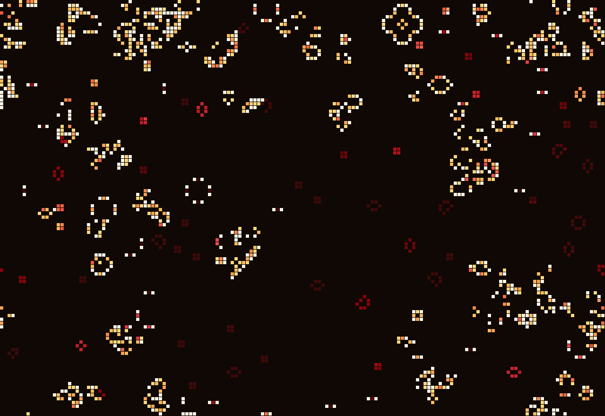
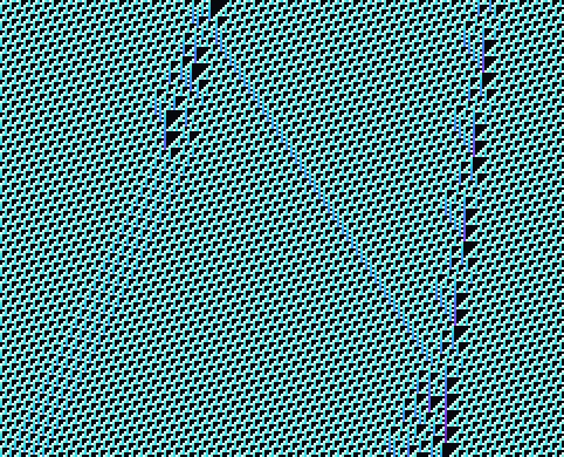

# AutomataLab

**[Live demo →](https://tanakriteuro.github.io/AutomataLab/)**

An interactive cellular automata playground that renders Conway's Game of Life and
Wolfram's elementary automata as generative art.

Simple local rules, applied everywhere at once, produce structure nobody put there.
AutomataLab is built to make that visible: cells are coloured by how long they have
survived, so gliders glow at their leading edge while stable debris sinks into the
deep end of the palette, and the difference between "moving" and "settled" becomes
something you can see at a glance rather than infer.

Fully client-side — no backend, no build-time data, deployable as a static site.

## Screenshots



*Conway's Life at generation 145, Ember palette. Cream cells were born this
generation; amber cells have survived a handful; the dark red blocks are still
lifes that have not changed in over a hundred generations. Same simulation in
black and white would be an undifferentiated field of dots.*



*Rule 110 — the Turing-complete one. Each row is one generation, time runs
downward.*

> Both images came straight out of the app's **Save as PNG** button, which exports
> the canvas at full pixel resolution with the palette background baked in.
> Replace them with your own captures at whatever settings you like best.
>
> **TODO:** record a short GIF of the 1D mode building a Sierpinski triangle row by
> row and drop it in as `docs/demo.gif` — the row-by-row construction is the part a
> still image cannot show.

## Automata implemented

### Life-like 2D automata

The generalisation of Conway's Game of Life. Every rule in this family is defined by
two sets of neighbour counts written in **B/S notation**: which counts cause a dead
cell to be *born*, and which counts let a live cell *survive*. Conway's Life is
`B3/S23` — born on exactly 3 neighbours, survives on 2 or 3.

Because a rule is exactly a pair of subsets of 0–8, the UI edits it as eighteen
toggle buttons rather than a text field. There are 2^18 = 262,144 such rules; the
presets are the handful that behave interestingly:

| Rule | Notation | What's distinctive |
|---|---|---|
| Conway's Life | `B3/S23` | Balanced on the edge between dying out and overcrowding — which is why it supports gliders, oscillators and universal computation |
| HighLife | `B36/S23` | One extra birth digit is enough to produce a self-replicating pattern |
| Seeds | `B2/S` | Nothing ever survives; all growth is birth, giving explosive firework sprays |
| Day & Night | `B3678/S34678` | Symmetric under swapping live and dead — patterns behave identically on an inverted background |
| Maze | `B3/S12345` | Freezes into intricate corridors that keep extending at their tips |
| Diamoeba | `B35678/S5678` | Large amoeba-like blobs with restless, churning boundaries |
| Replicator | `B1357/S1357` | Every pattern copies itself into fractal, Sierpinski-like structures |

Pattern stamps: glider, lightweight spaceship, blinker, pulsar, R-pentomino, acorn,
and the Gosper glider gun. Edges can be **toroidal** (the grid is a torus — patterns
leaving one side reappear on the other) or **bounded** (everything outside is
permanently dead).

### Elementary 1D automata

Wolfram's one-dimensional case. A single row evolves, and each new generation is
drawn beneath the last, so the image that builds up is the automaton's entire
history rather than its current state.

A cell sees only itself and its two neighbours. Three binary inputs means eight
possible neighbourhoods, and a rule assigns an output bit to each — eight bits, so
there are exactly **256 rules**, and the UI shows all eight decisions of the
current one as a clickable diagram.

- **Rule 30** — chaotic. Its centre column was used as a random number generator in
  Mathematica, and whether that column is ever periodic is still open.
- **Rule 90** — each cell is the XOR of its two neighbours, which draws the
  Sierpinski triangle exactly. A fractal from a two-input logic gate.
- **Rule 110** — **proven Turing-complete.** Anything your computer can compute,
  this one-line rule can compute too, given the right starting row.
- **Rule 184** — a traffic model; conserves the number of live cells exactly.
- **Rule 150**, **Rule 54** — nested self-similar structure, and class-4 gliders.

## Running locally

```bash
npm install
npm run dev      # http://localhost:5173
```

```bash
npm test         # engine unit tests
npm run build    # typecheck + production build to dist/
npm run lint
npm run preview  # serve the production build
```

Node 20+ recommended. `dist/` is a static bundle — drop it on any static host.

## How it's put together

```
src/
  engine/       pure simulation logic — no canvas, no React, no DOM
    rule.ts             B/S notation: parse, format, toggle, describe
    lifeGrid.ts         the 2D life-like engine
    elementary.ts       the 1D elementary engine
    patterns.ts         famous patterns as ASCII art
    presets.ts          named rule sets
  render/       canvas drawing — no React
    gridRenderer.ts     2D grid painter with incremental redraw
    stripRenderer.ts    1D history painter with scrolling
    palettes.ts         age -> colour ramps
    exportPng.ts        canvas -> PNG download
  hooks/        the React glue
  components/   the UI shell
```

The **engine is fully decoupled from rendering and from React** — it takes a grid
and a rule and computes the next state, which is what makes it unit-testable
without a canvas or a DOM.

### Performance notes

The rendering target was 100×100 at 30fps. The app sustains a measured **60 ticks
per second at 240×160** (38,400 cells) in headless Chromium, from three decisions:

1. **Column-sum neighbour counting.** Rather than 8 bounds-checked reads per cell,
   each row builds a vertical 3-cell sum per column, after which a cell's
   neighbourhood is `colSum[x-1] + colSum[x] + colSum[x+1] - self`. Buffers are
   allocated once and reused, so stepping allocates nothing.
2. **Incremental canvas redraw.** The renderer remembers the colour band it last
   painted for each cell and repaints only cells whose band changed. On a settled
   grid that is a handful of rects per frame instead of tens of thousands.
3. **React kept out of the hot path.** The simulation is stepped and drawn inside a
   single `requestAnimationFrame` loop that reads its settings from a ref. Running
   at 60 ticks/second triggers *no* React re-renders — only the stats readout is
   pushed into state, four times a second.

Full HashLife/quadtree optimisation is deliberately out of scope.

### Tests

```bash
npm test
```

39 tests covering the engines, verifying behaviour against the literature rather
than against the implementation:

- a **glider translates by exactly (1,1) every 4 generations**, for four consecutive periods
- a block is stable, a blinker has period 2, a pulsar has period 3
- a **lightweight spaceship** moves 2 cells sideways every 4 generations
- the **Gosper glider gun** adds exactly 5 cells to the population every 30 generations
- the **R-pentomino** is still changing past generation 1000
- a glider on a toroidal grid returns to its exact starting position after `4 × size` generations
- bounded and toroidal edges are verified to *disagree* on the same starting row
- **Rule 90** reproduces the Sierpinski triangle and equals XOR of its neighbours
- **Rule 184** conserves live-cell count over 50 generations
- every rule number round-trips through its eight-bit neighbourhood decomposition
- age tracking increments for survivors and resets on death

## What I learned

> *Personalise this section — the notes below are prompts, not prose to keep.*

- **Where the performance actually goes.** The naive assumption is that the
  simulation is the bottleneck. It isn't: stepping a 38,400-cell grid is a few
  hundred microseconds, while repainting every cell every frame is what costs. The
  win came from diffing what to draw, not from a cleverer automaton.
- **Separating the engine from the renderer paid for itself immediately.** Because
  `LifeGrid` never touches a canvas, the glider and glider-gun tests are ordinary
  array assertions, and I caught two wrong assumptions of my own that way.
- **Boundary conditions are part of the rule, not part of the world.** Edge mode
  started as a field on the grid and became a parameter to `step()` — which removed
  hidden mutable state and meant toggling wrapped/bounded no longer rebuilds the grid.
- **Colour by age is the whole visual difference.** Same simulation, same rules;
  tracking one extra integer per cell is what separates a textbook demo from
  something worth screenshotting.
- **Rule 110 being Turing-complete still seems unreasonable.** Eight bits of rule,
  applied to a line of cells, is a universal computer.

## Licence

MIT.

## Deploying

Live at **<https://tanakriteuro.github.io/AutomataLab/>**. `.github/workflows/deploy.yml` tests,
builds and publishes to GitHub Pages on every push to `main` (repo Settings → Pages →
Source: GitHub Actions). Pages serves it from a subpath, so `vite.config.ts` sets
`base: '/AutomataLab/'` (case-sensitive, matching the repo name).

The old Vercel URL (<https://automatalab-opal.vercel.app>) permanently redirects here via
`vercel.json`.
